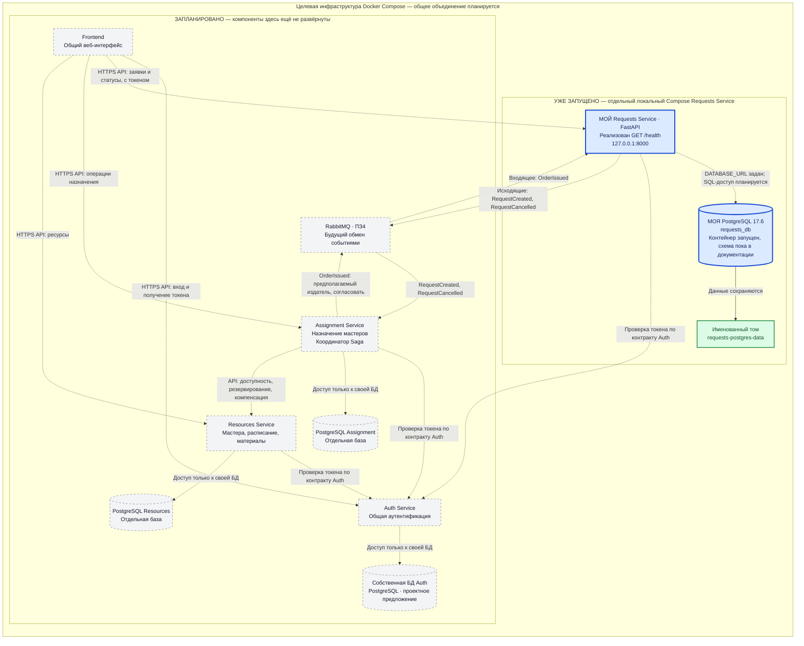

# RepairFlow — архитектура для отчёта ПЗ2

## 1. Текущее состояние и цель

RepairFlow — микросервисная система обработки заявок на выездной ремонт.
Этот документ показывает целевую архитектуру команды и отдельно выделяет
реализованную часть: мой Requests Service на FastAPI и его PostgreSQL 17.6,
запущенные через локальный Docker Compose.

Сейчас реализован только `GET /health`, возвращающий HTTP 200 и
`{"status":"ok"}`. Приложение получает `DATABASE_URL`, но ещё не выполняет
запросы к базе. Схема четырёх таблиц описана в
[database-design.md](database-design.md); реальные таблицы и CRUD пока не созданы.
RabbitMQ и обработка событий запланированы на ПЗ4, бизнес-логика — на ПЗ3.

## 2. Общая архитектурная схема

Синим выделены мои Requests Service и `requests_db`. Внутренний блок
«УЖЕ ЗАПУЩЕНО» соответствует существующему локальному `docker-compose.yml`.
Серые компоненты с пунктирной рамкой запланированы. Пунктирные стрелки
показывают будущие взаимодействия, включая SQL-доступ Requests Service.
Сплошная стрелка показывает существующее подключение тома к PostgreSQL.

Внешний блок показывает план будущей общей Compose-инфраструктуры команды.
Он не означает, что все изображённые компоненты уже включены в текущий
Compose. Набор маршрутов Frontend и способ размещения Frontend в общей
инфраструктуре также предстоит согласовать.

## 3. Компоненты и границы ответственности

| Компонент | Ответственность | Состояние на ПЗ2 |
| --- | --- | --- |
| Frontend | Общий интерфейс: вход, оформление заявок, отображение статусов и доступных пользователю операций | Запланирован |
| Auth Service | Аутентификация и контракт проверки токенов; единый источник сведений о личности пользователя | Запланирован; механизм токенов и матрица ролей требуют согласования |
| **Requests Service — мой сервис** | Владеет заявками, их статусами и историей; хранит адрес, проблему, желаемый интервал и копию контактов назначенного мастера | Запущен FastAPI с `/health`; бизнес-операции запланированы |
| **PostgreSQL `requests_db` — моя база** | Только данные Requests Service: будущие `requests`, `request_status_history`, `outbox`, `processed_messages` | PostgreSQL 17.6 запущена; структура таблиц пока только спроектирована |
| Assignment Service | Владеет процессом назначения и состоянием Saga; координирует шаги назначения и компенсации при ошибках | Запланирован, имеет собственную PostgreSQL |
| Resources Service | Владеет мастерами, их расписанием, материалами и правилами резервирования ресурсов | Запланирован, имеет собственную PostgreSQL |
| RabbitMQ | Передаёт события между сервисами по согласованным контрактам | Запланирован на ПЗ4 |
| Docker Compose | Локально создаёт контейнеры, сеть и тома, задаёт окружение и зависимости запуска | Отдельный Compose Requests Service реализован; общий Compose команды запланирован |

Requests Service хранит результат назначения, но не выбирает мастера,
не управляет его расписанием и не координирует Saga. Assignment Service
организует назначение, а Resources Service проверяет и резервирует ресурсы.
Auth Service не владеет заявками. RabbitMQ передаёт сообщения и не принимает
бизнес-решения вместо сервисов.

У каждого бизнес-микросервиса собственная PostgreSQL; сервисы не читают
и не изменяют чужие таблицы. Для Auth на схеме предложена отдельная PostgreSQL,
окончательный выбор хранилища относится к ответственности владельца Auth.
Имена баз Assignment, Resources и Auth ещё не закреплены.

## 4. Синхронные взаимодействия

Frontend в целевой архитектуре обращается к API сервисов. После входа через
Auth он передаёт полученный токен при обращениях к защищённым операциям.
Проверку личности и прав выполняют сервисы; конкретный способ проверки
токена, формат внешних ID и роли команда должна согласовать.
Стрелки к Auth обозначают зависимость от его контракта, а не обязательный
сетевой запрос в Auth при каждом обращении: возможен вариант локальной
проверки подписи токена.

Для координации Saga предложено взаимодействие Assignment → Resources
через API: проверить доступность мастера, зарезервировать время и необходимые
материалы, при необходимости отменить резервирование. Конкретные операции,
порядок шагов и транспорт этого взаимодействия требуют согласования;
сейчас такие вызовы не реализованы.

## 5. Будущий обмен событиями

| Событие по ПЗ1 | Направление для Requests Service | Планируемый маршрут и смысл |
| --- | --- | --- |
| `RequestCreated` | Исходящее | Requests → RabbitMQ → Assignment; сообщает о создании заявки для дальнейшего процесса назначения |
| `RequestCancelled` | Исходящее | Requests → RabbitMQ → Assignment; сообщает об отмене заявки для обработки отмены процесса и необходимых компенсаций |
| `OrderIssued` | Входящее | RabbitMQ → Requests; событие выдачи заказа из другого сервиса. На схеме предполагается издатель Assignment, это нужно подтвердить с командой |

Направления событий и названия согласованы с описанием БД. Payload
`OrderIssued`, его точное значение для заявки и сервис-издатель требуют
подтверждения; документ не закрепляет автоматический переход статуса
на основании одного названия события. Очереди, exchange, routing keys,
правила повторов и остальные контракты будут определены на ПЗ4.

Для надёжной отправки исходящих событий предусмотрена таблица `outbox`:
изменение заявки и запись события будут фиксироваться одной транзакцией,
а будущий отправитель опубликует событие в RabbitMQ. Для входящих сообщений
предусмотрена `processed_messages`, чтобы повторная доставка не приводила
к повторному применению изменений. Эти механизмы пока только спроектированы.
Отмена назначения с возвратом `assigned → new` сама по себе не является
отменой заявки и не создаёт `RequestCancelled`.

## 6. Изоляция данных и локальная инфраструктура

`client_id` и `assigned_master_id` — внешние идентификаторы без FK на базы
Auth или Resources. `assigned_master_name` и `assigned_master_phone` — локальная
копия контактных данных, полученных по контракту другого сервиса; Requests
не становится владельцем профиля мастера. Правила актуализации копии ещё
предстоит согласовать. Внутренние FK существуют только между таблицами
Requests Service, как описано в проекте БД.

Существующий локальный Compose запускает ровно два контейнера:

- `requests-service` — собирается из Dockerfile, получает `DATABASE_URL`,
  публикует HTTP-порт на `127.0.0.1:8000`;
- `postgres` — образ `postgres:17.6`, настройки из локального `.env`,
  healthcheck через `pg_isready`, данные в именованном томе
  `requests-postgres-data`. Порт базы не опубликован на компьютер.

Compose ожидает состояние PostgreSQL `healthy` перед запуском приложения.
Эта зависимость управляет начальным запуском, а `/health` сейчас проверяет
доступность FastAPI и не проверяет соединение с БД. Готовность базы и
доступность приложения — отдельные проверки.

При интеграции в общий Compose потребуется согласовать имена сервисов,
сети, порты и переменные окружения. Этот документ не меняет существующую
конфигурацию, не создаёт таблицы и не выполняет операции с контейнерами.
