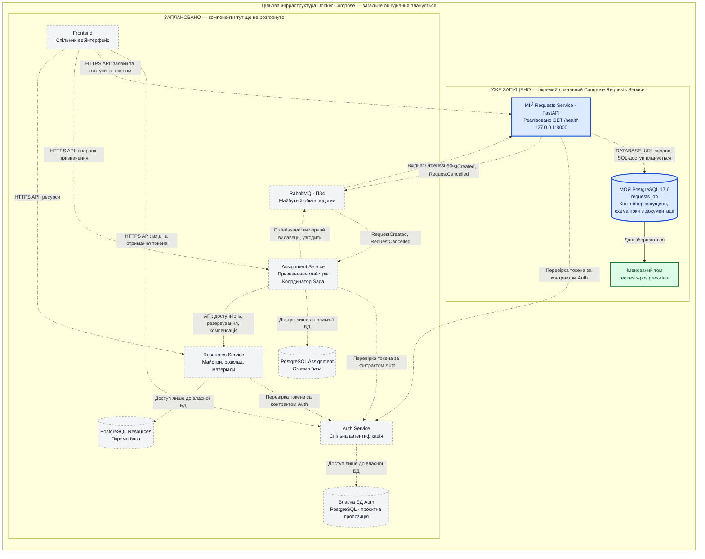

# RepairFlow — архітектура для звіту ПЗ2

## 1. Поточний стан і мета

RepairFlow — мікросервісна система обробки заявок на виїзний ремонт.
Цей документ показує цільову архітектуру команди та окремо виділяє
реалізовану частину: мій Requests Service на FastAPI та його PostgreSQL 17.6,
запущені через локальний Docker Compose.

Наразі реалізовано лише `GET /health`, що повертає HTTP 200 і
`{"status":"ok"}`. Застосунок отримує `DATABASE_URL`, але ще не виконує
запитів до бази. Схему чотирьох таблиць описано в
[database-design.md](database-design.md); реальні таблиці та CRUD поки не створено.
RabbitMQ та обробку подій заплановано на ПЗ4, бізнес-логіку — на ПЗ3.

## 2. Загальна архітектурна схема

Синім виділено мої Requests Service і `requests_db`. Внутрішній блок
«УЖЕ ЗАПУЩЕНО» відповідає наявному локальному `docker-compose.yml`.
Сірі компоненти з пунктирною рамкою заплановано. Пунктирні стрілки
показують майбутні взаємодії, зокрема SQL-доступ Requests Service.
Суцільна стрілка показує наявне підключення тому до PostgreSQL.

Зовнішній блок показує план майбутньої спільної Compose-інфраструктури команди.
Він не означає, що всі зображені компоненти вже включено до поточного
Compose. Набір маршрутів Frontend і спосіб розміщення Frontend у спільній
інфраструктурі також потрібно узгодити.

## 3. Компоненти та межі відповідальності

| Компонент | Відповідальність | Стан на ПЗ2 |
| --- | --- | --- |
| Frontend | Спільний інтерфейс: вхід, оформлення заявок, відображення статусів і доступних користувачу операцій | Заплановано |
| Auth Service | Автентифікація та контракт перевірки токенів; єдине джерело відомостей про особу користувача | Заплановано; механізм токенів і матриця ролей потребують узгодження |
| **Requests Service — мій сервіс** | Володіє заявками, їхніми статусами та історією; зберігає адресу, проблему, бажаний інтервал і копію контактів призначеного майстра | Запущено FastAPI з `/health`; бізнес-операції заплановано |
| **PostgreSQL `requests_db` — моя база** | Лише дані Requests Service: майбутні `requests`, `request_status_history`, `outbox`, `processed_messages` | PostgreSQL 17.6 запущено; структуру таблиць поки лише спроєктовано |
| Assignment Service | Володіє процесом призначення та станом Saga; координує кроки призначення й компенсації в разі помилок | Заплановано, має власну PostgreSQL |
| Resources Service | Володіє даними майстрів, їхнім розкладом, матеріалами та правилами резервування ресурсів | Заплановано, має власну PostgreSQL |
| RabbitMQ | Передає події між сервісами за узгодженими контрактами | Заплановано на ПЗ4 |
| Docker Compose | Локально створює контейнери, мережу й томи, задає середовище та залежності запуску | Окремий Compose Requests Service реалізовано; загальний Compose команди заплановано |

Requests Service зберігає результат призначення, але не обирає майстра,
не керує його розкладом і не координує Saga. Assignment Service
організовує призначення, а Resources Service перевіряє та резервує ресурси.
Auth Service не володіє заявками. RabbitMQ передає повідомлення й не ухвалює
бізнес-рішень замість сервісів.

Кожен бізнес-мікросервіс має власну PostgreSQL; сервіси не читають
і не змінюють чужих таблиць. Для Auth на схемі запропоновано окрему PostgreSQL,
остаточний вибір сховища належить до відповідальності власника Auth.
Назви баз Assignment, Resources і Auth ще не закріплено.

## 4. Синхронні взаємодії

Frontend у цільовій архітектурі звертається до API сервісів. Після входу через
Auth він передає отриманий токен під час звернень до захищених операцій.
Перевірку особи та прав виконують сервіси; конкретний спосіб перевірки
токена, формат зовнішніх ID і ролі команда має узгодити.
Стрілки до Auth позначають залежність від його контракту, а не обов’язковий
мережевий запит до Auth під час кожного звернення: можливий варіант локальної
перевірки підпису токена.

Для координації Saga запропоновано взаємодію Assignment → Resources
через API: перевірити доступність майстра, зарезервувати час і необхідні
матеріали, за потреби скасувати резервування. Конкретні операції,
порядок кроків і транспорт цієї взаємодії потребують узгодження;
наразі такі виклики не реалізовано.

## 5. Майбутній обмін подіями

| Подія за ПЗ1 | Напрямок для Requests Service | Запланований маршрут і зміст |
| --- | --- | --- |
| `RequestCreated` | Вихідна | Requests → RabbitMQ → Assignment; повідомляє про створення заявки для подальшого процесу призначення |
| `RequestCancelled` | Вихідна | Requests → RabbitMQ → Assignment; повідомляє про скасування заявки для обробки скасування процесу та необхідних компенсацій |
| `OrderIssued` | Вхідна | RabbitMQ → Requests; подія видачі замовлення з іншого сервісу. На схемі імовірним видавцем є Assignment, це потрібно підтвердити з командою |

Напрямки подій і назви узгоджено з описом БД. Корисне навантаження
`OrderIssued`, його точне значення для заявки та сервіс-видавець потребують
підтвердження; документ не закріплює автоматичного переходу статусу
на підставі самої назви події. Черги, exchange, routing keys,
правила повторів та решту контрактів буде визначено на ПЗ4.

Для надійного надсилання вихідних подій передбачено таблицю `outbox`:
зміну заявки та запис події буде зафіксовано однією транзакцією,
а майбутній відправник опублікує подію в RabbitMQ. Для вхідних повідомлень
передбачено `processed_messages`, щоб повторна доставка не призводила
до повторного застосування змін. Ці механізми поки лише спроєктовано.
Скасування призначення з поверненням `assigned → new` саме собою не є
скасуванням заявки та не створює `RequestCancelled`.

## 6. Ізоляція даних і локальна інфраструктура

`client_id` і `assigned_master_id` — зовнішні ідентифікатори без FK на бази
Auth або Resources. `assigned_master_name` і `assigned_master_phone` — локальна
копія контактних даних, отриманих за контрактом іншого сервісу; Requests
не стає власником профілю майстра. Правила актуалізації копії ще
потрібно узгодити. Внутрішні FK існують лише між таблицями
Requests Service, як описано в проєкті БД.

Наявний локальний Compose запускає рівно два контейнери:

- `requests-service` — збирається з Dockerfile, отримує `DATABASE_URL`,
  публікує HTTP-порт на `127.0.0.1:8000`;
- `postgres` — образ `postgres:17.6`, налаштування з локального `.env`,
  healthcheck через `pg_isready`, дані в іменованому томі
  `requests-postgres-data`. Порт бази не опубліковано на комп’ютері.

Compose очікує стану PostgreSQL `healthy` перед запуском застосунку.
Ця залежність керує початковим запуском, а `/health` наразі перевіряє
доступність FastAPI й не перевіряє з’єднання з БД. Готовність бази та
доступність застосунку — окремі перевірки.

Під час інтеграції в загальний Compose потрібно буде узгодити назви сервісів,
мережі, порти та змінні середовища. Цей документ не змінює наявної
конфігурації, не створює таблиць і не виконує операцій із контейнерами.
