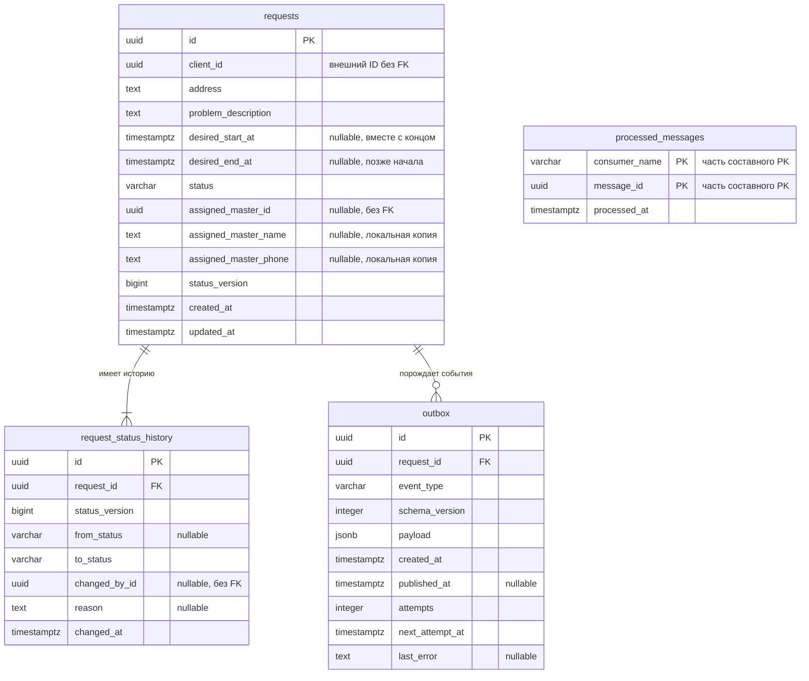

# RepairFlow — проект базы данных Requests Service

## 1. Назначение и границы

Документ подготовлен для ПЗ2. Он описывает проект схемы PostgreSQL 17.6,
но не создаёт таблицы, миграции, CRUD, обработчики сообщений или RabbitMQ.
Существующие данные и контейнеры не изменяются.

Requests Service владеет своей базой `requests_db` и четырьмя таблицами:

| Таблица | Назначение |
| --- | --- |
| `requests` | Текущее состояние заявки клиента |
| `request_status_history` | Последовательная история статусов заявки |
| `outbox` | События, которые предстоит отправить другим сервисам |
| `processed_messages` | Учёт уже обработанных входящих сообщений |

Каждый микросервис имеет собственную базу данных. `client_id`,
`assigned_master_id` и `changed_by_id` являются внешними идентификаторами,
но **не внешними ключами**: таблиц клиентов, мастеров и пользователей в этой
базе нет. Существование и права этих участников будут проверяться через
контракты сервисов, а не через SQL-запросы к чужой базе.

## 2. Общие соглашения

- Идентификаторы сущностей и сообщений — `uuid`. Для проекта предполагается,
  что команда использует UUID во всех сервисах; это требует согласования.
  Новые UUID генерирует приложение, поэтому расширения PostgreSQL не нужны.
- Все даты имеют тип `timestamptz`. API должен принимать время с часовым поясом;
  приложение и сессии БД используют UTC, интерфейс отображает местное время.
- `NOT NULL` означает обязательное значение; `NULL` разрешён только там,
  где это прямо указано. `DEFAULT` не запрещает явное значение `NULL`.
- Текстовые поля адреса и описания проверяются через
  `CHECK (length(btrim(поле)) > 0)` в дополнение к `NOT NULL`.
- Статусы хранятся в `varchar(20)` с `CHECK`, без отдельной таблицы и SQL ENUM.
  Разрешены только `new`, `assigned`, `in_progress`, `closed`, `cancelled`.
- Удаление заявок физически пока не предусмотрено. Отмена — переход в
  `cancelled`. Внешние ключи внутри сервиса используют `ON DELETE RESTRICT`
  и `ON UPDATE RESTRICT`, чтобы не потерять историю и ожидающие события.

## 3. Таблица `requests`

Одна строка содержит актуальные данные одной заявки.

| Поле | Тип PostgreSQL | NULL | Ключи, значения по умолчанию и ограничения | Назначение |
| --- | --- | --- | --- | --- |
| `id` | `uuid` | нет | PRIMARY KEY; задаёт приложение | Идентификатор заявки |
| `client_id` | `uuid` | нет | Без FK на другие сервисы | Клиент, создавший заявку |
| `address` | `text` | нет | CHECK: непустой текст после `btrim` | Адрес выезда, сохранённый в заявке |
| `problem_description` | `text` | нет | CHECK: непустой текст после `btrim` | Описание неисправности |
| `desired_start_at` | `timestamptz` | да | DEFAULT NULL; заполняется вместе с `desired_end_at` | Начало желаемого интервала визита |
| `desired_end_at` | `timestamptz` | да | DEFAULT NULL; строго позже `desired_start_at` | Конец желаемого интервала визита |
| `status` | `varchar(20)` | нет | DEFAULT 'new'; CHECK на пять статусов | Текущий статус |
| `assigned_master_id` | `uuid` | да | DEFAULT NULL; без внешнего FK | Назначенный мастер |
| `assigned_master_name` | `text` | да | DEFAULT NULL; CHECK: NULL или непустой текст после `btrim` | Локальная копия имени назначенного мастера |
| `assigned_master_phone` | `text` | да | DEFAULT NULL; CHECK: NULL или непустой текст после `btrim` | Локальная копия телефона назначенного мастера |
| `status_version` | `bigint` | нет | DEFAULT 1; CHECK > 0 | Порядковый номер текущего статуса |
| `created_at` | `timestamptz` | нет | DEFAULT CURRENT_TIMESTAMP | Время создания |
| `updated_at` | `timestamptz` | нет | DEFAULT CURRENT_TIMESTAMP; CHECK >= `created_at` | Время последнего изменения |

Дополнительные ограничения строки:

```sql
CHECK (status IN ('new', 'assigned', 'in_progress', 'closed', 'cancelled'))
CHECK (
    (desired_start_at IS NULL AND desired_end_at IS NULL)
    OR (
        desired_start_at IS NOT NULL
        AND desired_end_at IS NOT NULL
        AND desired_end_at > desired_start_at
    )
)
CHECK (
    status <> 'new'
    OR (
        assigned_master_id IS NULL
        AND assigned_master_name IS NULL
        AND assigned_master_phone IS NULL
    )
)
CHECK (
    assigned_master_id IS NOT NULL
    OR (assigned_master_name IS NULL AND assigned_master_phone IS NULL)
)
CHECK (assigned_master_name IS NULL OR length(btrim(assigned_master_name)) > 0)
CHECK (assigned_master_phone IS NULL OR length(btrim(assigned_master_phone)) > 0)
CHECK (
    status NOT IN ('assigned', 'in_progress', 'closed')
    OR assigned_master_id IS NOT NULL
)
CHECK (status_version > 0)
CHECK (updated_at >= created_at)
```

Для `cancelled` мастер может отсутствовать либо сохраняться вместе с копией
контактов для аудита. У закрытой заявки сохраняются назначенный мастер и
полученные контакты. При `assigned → new` все три поля `assigned_master_*`
очищаются в одной транзакции со сменой статуса. Эти проверки обеспечивают
совместимость полей строки, но не проверяют переход из предыдущего статуса.

`assigned_master_name` и `assigned_master_phone` — локальный снимок данных,
полученных из другого сервиса при назначении мастера. Внешних ключей для этих
полей нет; синхронное чтение чужой базы не требуется. Телефон хранится текстом,
чтобы сохранять `+` и ведущие нули. Правила формата телефона, обязательность
обоих контактов при назначении и обновление снимка при изменении профиля
нужно согласовать в контракте сервисов. Пока допускается отсутствие отдельных
контактов при наличии ID; без ID контакты храниться не могут.

`updated_at` должно обновляться приложением при каждом изменении заявки:
`DEFAULT CURRENT_TIMESTAMP` действует при вставке и не обновляет поле сам.
`status_version` увеличивается только при смене статуса; он не является
универсальной версией всех изменений заявки.

Адрес хранится как снимок на момент оформления и не меняется автоматически
при изменении профиля клиента. Желаемое время задаётся интервалом
`desired_start_at` — `desired_end_at`, конец которого строго позже начала.
До согласования обязательности интервала оба поля могут быть NULL одновременно,
что означает отсутствие пожелания; заполнить только одну границу нельзя.
Проверку «не в прошлом» следует выполнять при вводе в приложении:
у уже созданной заявки желаемое время естественным образом становится прошлым.

Предлагаемые индексы, помимо индекса PRIMARY KEY:

| Индекс | Назначение |
| --- | --- |
| `(client_id, created_at DESC)` | Список заявок клиента |
| `(status, created_at)` | Очередь заявок определённого статуса |
| `(assigned_master_id, status)` WHERE `assigned_master_id IS NOT NULL` | Заявки назначенного мастера |

## 4. Таблица `request_status_history`

История дополняется новыми строками; существующие записи не редактируются.
При создании заявки добавляется начальная запись `NULL → new`.

| Поле | Тип PostgreSQL | NULL | Ключи, значения по умолчанию и ограничения | Назначение |
| --- | --- | --- | --- | --- |
| `id` | `uuid` | нет | PRIMARY KEY; задаёт приложение | Идентификатор записи истории |
| `request_id` | `uuid` | нет | FK → `requests.id`, RESTRICT | Заявка |
| `status_version` | `bigint` | нет | CHECK > 0 | Номер статуса внутри заявки |
| `from_status` | `varchar(20)` | да | CHECK: NULL или один из пяти статусов | Предыдущий статус; NULL только для создания |
| `to_status` | `varchar(20)` | нет | CHECK на пять статусов | Новый статус |
| `changed_by_id` | `uuid` | да | Без внешнего FK | Инициатор; NULL для системного изменения |
| `reason` | `text` | да | CHECK: NULL или непустой текст после `btrim` | Причина или комментарий |
| `changed_at` | `timestamptz` | нет | DEFAULT CURRENT_TIMESTAMP | Время изменения |

Ограничение `UNIQUE (request_id, status_version)` запрещает две записи
одной версии и позволяет читать историю по номеру, даже если время совпадает.
Этот индекс также обслуживает поиск истории по `request_id`.

Дополнительный CHECK допускает только начальную запись или один из переходов:

```sql
CHECK (
    (from_status IS NULL AND to_status = 'new' AND status_version = 1)
    OR
    (
        from_status IS NOT NULL
        AND status_version > 1
        AND (
            (from_status = 'new' AND to_status IN ('assigned', 'cancelled'))
            OR (from_status = 'assigned' AND to_status IN ('new', 'in_progress', 'cancelled'))
            OR (from_status = 'in_progress' AND to_status IN ('closed', 'cancelled'))
        )
    )
)
```

Переход `assigned → new` включён в проект CHECK как предложение для согласования
с командой. `in_progress → cancelled` также остаётся предварительным допущением,
а не окончательно утверждённым правилом. Перед реализацией ограничений нужно
подтвердить оба перехода и при необходимости скорректировать CHECK и таблицу
переходов в разделе 8.

FK гарантирует существование заявки. UNIQUE и CHECK не гарантируют отсутствие
пропусков версий, совпадение последнего `to_status` с `requests.status` или
совпадение `from_status` с предыдущей записью. Это будущие обязанности
приложения в общей транзакции с блокировкой строки заявки.

## 5. Таблица `outbox`

Хранит исходящие события Requests Service до и после публикации. Это подготовка
к ПЗ4: отправителя событий и подключения к RabbitMQ сейчас нет.

| Поле | Тип PostgreSQL | NULL | Ключи, значения по умолчанию и ограничения | Назначение |
| --- | --- | --- | --- | --- |
| `id` | `uuid` | нет | PRIMARY KEY; задаёт приложение | Стабильный ID события и будущий message_id |
| `request_id` | `uuid` | нет | FK → `requests.id`, RESTRICT | Заявка, к которой относится событие |
| `event_type` | `varchar(100)` | нет | CHECK: непустое значение после `btrim` | Исходящие события `RequestCreated` и `RequestCancelled` согласно ПЗ1 |
| `schema_version` | `integer` | нет | DEFAULT 1; CHECK > 0 | Версия формата события |
| `payload` | `jsonb` | нет | CHECK (`jsonb_typeof(payload) = 'object'`); без DEFAULT | Данные события по будущему контракту |
| `created_at` | `timestamptz` | нет | DEFAULT CURRENT_TIMESTAMP | Время регистрации события |
| `published_at` | `timestamptz` | да | DEFAULT NULL; CHECK: NULL или >= `created_at` | Время подтверждённой публикации |
| `attempts` | `integer` | нет | DEFAULT 0; CHECK >= 0 | Количество попыток отправки |
| `next_attempt_at` | `timestamptz` | нет | DEFAULT CURRENT_TIMESTAMP; CHECK >= `created_at` | Когда разрешена следующая попытка |
| `last_error` | `text` | да | DEFAULT NULL | Причина последней ошибки отправки |

`published_at IS NULL` означает, что событие ожидает отправки или повтора.
Отдельный статус доставки не нужен. `payload` должен содержать только данные,
необходимые получателям; пароль и строка подключения в события не включаются.

Направления событий согласно ПЗ1:

| Событие | Направление относительно Requests Service | Назначение |
| --- | --- | --- |
| `RequestCreated` | Исходящее, через `outbox` | Уведомление о создании заявки |
| `RequestCancelled` | Исходящее, через `outbox` | Уведомление об отмене заявки |
| `OrderIssued` | Входящее, учёт в `processed_messages` | Получение события, выпущенного другим сервисом |

`OrderIssued` не записывается в outbox как исходящее событие Requests Service.
Его payload и влияние на заявку требуют согласованного контракта; из одного
названия нельзя определить обновляемые поля или переход статуса. Названия
исходящих событий для остальных изменений здесь не вводятся.

Предлагаемые индексы:

- `(next_attempt_at, created_at, id)` WHERE `published_at IS NULL` — выборка
  событий для отправки;
- `(request_id, created_at, id)` — поиск событий заявки и обслуживание FK.

В будущей реализации изменение заявки, история и необходимая запись outbox
выполняются одной транзакцией. При создании записывается `RequestCreated`,
при переходе в `cancelled` — `RequestCancelled`. Нужны ли исходящие события
для остальных переходов, следует согласовать отдельно.
Отдельный отправитель читает только зафиксированные события,
увеличивает `attempts` и отмечает `published_at` после подтверждения брокера.
При ошибке он сохраняет `last_error` и планирует `next_attempt_at`.
Если отправителей несколько, потребуется согласованный захват строк,
например блокировка строк на время отправки; один лишь индекс этого не решает.

После отправки процесс может завершиться до сохранения `published_at`.
Поэтому возможна повторная доставка с тем же `outbox.id`: outbox сам по себе
не обеспечивает «ровно один раз». Порядок доставки событий одной заявки
потребует отдельного решения в ПЗ4; сортировка очереди его не гарантирует.

## 6. Таблица `processed_messages`

Хранит идентификаторы успешно обработанных входящих сообщений и помогает
не применять одно и то же событие повторно.

Пример входящего события — `OrderIssued`. В этой таблице сохраняется его
message_id для защиты от повторной обработки, а не исходящее событие outbox.

| Поле | Тип PostgreSQL | NULL | Ключи, значения по умолчанию и ограничения | Назначение |
| --- | --- | --- | --- | --- |
| `consumer_name` | `varchar(100)` | нет | Часть PRIMARY KEY; CHECK: непустой текст после `btrim` | Стабильное имя логического обработчика |
| `message_id` | `uuid` | нет | Часть PRIMARY KEY | ID события, присвоенный отправителем |
| `processed_at` | `timestamptz` | нет | DEFAULT CURRENT_TIMESTAMP | Время регистрации успешной обработки |

Составной `PRIMARY KEY (consumer_name, message_id)` запрещает повторную
обработку одного сообщения одним логическим обработчиком. Все экземпляры
одного обработчика используют одинаковое `consumer_name`; имя контейнера
для этого не подходит. Разные обработчики могут обработать одно событие.

Внешних ключей нет: сообщение может прийти из чужого сервиса или относиться
к операции без существующей заявки. `message_id` не является FK на локальный
`outbox`, поскольку это идентификатор **входящего**, а не исходящего события.
Прикладной контракт должен требовать сохранения message_id при повторной
отправке и глобальной уникальности UUID.

В ПЗ4 регистрация message_id, изменения заявки, история и новые исходящие
события должны фиксироваться одной транзакцией. Запись идентификатора
вставляется до применения изменений с проверкой конфликта PRIMARY KEY.
При конфликте изменения повторно не применяются. При ошибке вся транзакция
откатывается, включая вставку message_id; подтверждение брокеру отправляется
после успешного commit. Это также защищает от конкурентных дубликатов.

Для будущей очистки возможен индекс `(processed_at)`. Срок хранения нужно
согласовать с максимальным сроком повторной доставки: удаление записи
позволяет снова обработать старое сообщение.

## 7. ER-диаграмма и связи



- Одна заявка имеет одну или много записей истории; каждая запись относится
  ровно к одной заявке. Минимум одна запись — правило транзакции создания,
  а не гарантия одного внешнего ключа.
- Одна заявка имеет ноль или много записей outbox; каждое событие относится
  ровно к одной локальной заявке. После согласованной очистки outbox событий
  может не остаться, поэтому минимальная кратность здесь — ноль.
- `processed_messages` не имеет прямых связей с остальными таблицами.
- Связи с Auth Service и другими сервисами в ER-диаграмму этой базы не входят.

## 8. Допустимые переходы статусов

| Исходный статус | Новый статус | Условие и смысл |
| --- | --- | --- |
| Нет заявки | `new` | Создание; ID и контакты мастера отсутствуют, версия 1, начальная история |
| `new` | `assigned` | Назначен мастер; ID обязателен, полученные имя и телефон копируются локально |
| `new` | `cancelled` | Заявка отменена до назначения |
| `assigned` | `in_progress` | Назначенный мастер начал работу |
| `assigned` | `new` | Отказ мастера или отмена назначения; ID, имя и телефон мастера очищаются; проектное решение требует согласования с командой |
| `assigned` | `cancelled` | Отмена заявки до начала работ; ID и полученные контакты мастера сохраняются |
| `in_progress` | `closed` | Работа завершена; ID и полученные контакты мастера сохраняются |
| `in_progress` | `cancelled` | Возможность прекращения работы остаётся предварительным допущением; требуется решение команды |
| `closed` | — | Конечный статус |
| `cancelled` | — | Конечный статус |

Таблица описывает проект модели, включая явно отмеченные несогласованные
переходы. Отмена назначения `assigned → new` возвращает заявку в очередь
и не означает отмену самой заявки, поэтому сама по себе не порождает
`RequestCancelled`. После возврата возможно новое назначение `new → assigned`.
Прямое переназначение без смены статуса пока не определено.

Другие переходы в текущем проекте запрещены. Повторное присвоение текущего статуса не является
переходом и не создаёт новую историю или событие смены статуса.

При смене статуса будущая реализация должна в одной транзакции:

1. Заблокировать строку заявки, прочитать её актуальный статус и проверить
   разрешённый переход и права инициатора.
2. Обновить статус, необходимые поля, `updated_at` и увеличить
   `status_version` на один. При `assigned → new` одновременно установить
   `assigned_master_id`, `assigned_master_name`, `assigned_master_phone` в NULL.
3. Добавить историю с предыдущим и новым статусами и той же новой версией.
4. При переходе в `cancelled` записать `RequestCancelled` в outbox;
   для остальных переходов создавать события только после согласования
   соответствующих контрактов. Зафиксировать транзакцию.

При создании заявки аналогично атомарно создаются заявка, начальная история
и событие `RequestCreated` в outbox. При обработке входящего сообщения,
например `OrderIssued`, в эту же транзакцию
входит регистрация в `processed_messages`. Обычный CHECK строки `requests`
не знает её старого статуса и не заменяет эту проверку переходов.
На этапе ПЗ2 этот алгоритм только описан, а не реализован.

## 9. Неоднозначные требования и принятые допущения

| Вопрос | Предварительное решение или вопрос для согласования |
| --- | --- |
| Формат внешних ID не определён | UUID в документе — предварительное допущение; окончательный формат согласовать с Auth Service и сервисом мастеров |
| Обязательность желаемого интервала | Интервал задан `desired_start_at` и `desired_end_at`, конец строго позже начала; пока разрешены два NULL, обязательность согласовать |
| Контакты назначенного мастера | Локальные копии имени и телефона без внешних FK; обязательность, формат телефона и правила обновления согласовать с сервисом-источником |
| Состав адреса не определён | Один непустой текстовый снимок; координаты и отдельные части адреса пока не нужны |
| Отмена после начала работ | `in_progress → cancelled` оставлен в проекте как предварительное допущение; окончательное решение команда ещё не приняла |
| Отказ мастера или отмена назначения | Предложен `assigned → new` с очисткой ID, имени и телефона мастера; проектное решение требует согласования с командой |
| Повторное открытие и прямое переназначение | Не предусмотрены текущей моделью; после возврата в `new` возможно новое назначение, остальные сценарии согласовать отдельно |
| Кто имеет право назначать, отменять и закрывать заявку | Матрица ролей не задана; согласовать перед реализацией ПЗ3 |
| Обязательность причины отмены | `reason` необязателен; обязательность согласовать отдельно |
| Контракты событий | По ПЗ1 `RequestCreated` и `RequestCancelled` — исходящие, `OrderIssued` — входящее; payload, обработку `OrderIssued`, остальные события, маршрутизацию, порядок и повторы согласовать в ПЗ4 |
| Удаление и сроки хранения | Физического удаления заявок пока нет; сроки очистки истории, outbox и processed_messages не заданы |

Изменения этих допущений потребуют обновить документ и будущие миграции.
Сейчас никакие SQL-команды к работающей базе не выполняются.
