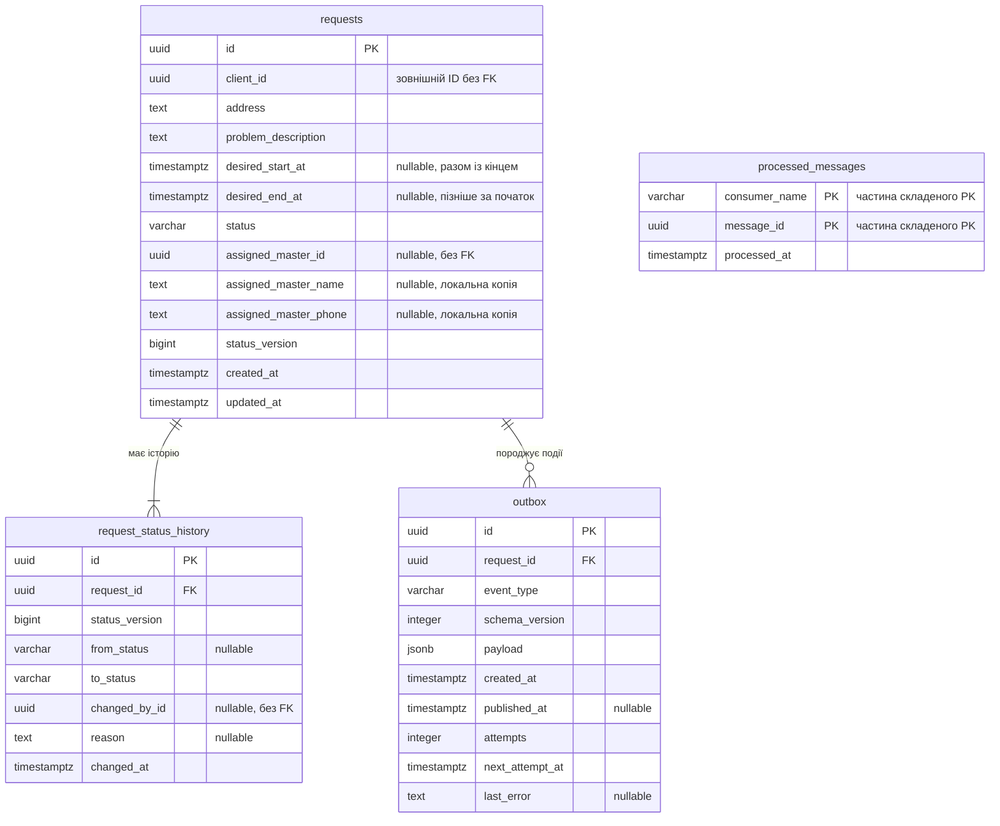

# RepairFlow — проєкт бази даних Requests Service

## 1. Призначення та межі

Документ підготовлено для ПЗ2. Він описує проєкт схеми PostgreSQL 17.6,
але не створює таблиць, міграцій, CRUD, обробників повідомлень або RabbitMQ.
Наявні дані та контейнери не змінюються.

Requests Service володіє власною базою `requests_db` і чотирма таблицями:

| Таблиця | Призначення |
| --- | --- |
| `requests` | Поточний стан заявки клієнта |
| `request_status_history` | Послідовна історія статусів заявки |
| `outbox` | Події, які потрібно надіслати іншим сервісам |
| `processed_messages` | Облік уже оброблених вхідних повідомлень |

Кожен мікросервіс має власну базу даних. `client_id`,
`assigned_master_id` і `changed_by_id` є зовнішніми ідентифікаторами,
але **не зовнішніми ключами**: таблиць клієнтів, майстрів і користувачів у цій
базі немає. Існування та права цих учасників перевірятимуться через
контракти сервісів, а не через SQL-запити до чужої бази.

## 2. Загальні домовленості

- Ідентифікатори сутностей і повідомлень — `uuid`. Для проєкту припускається,
  що команда використовує UUID в усіх сервісах; це потребує узгодження.
  Нові UUID генерує застосунок, тому розширення PostgreSQL не потрібні.
- Усі дати мають тип `timestamptz`. API має приймати час із часовим поясом;
  застосунок і сеанси БД використовують UTC, інтерфейс відображає місцевий час.
- `NOT NULL` означає обов’язкове значення; `NULL` дозволено лише там,
  де це прямо зазначено. `DEFAULT` не забороняє явного значення `NULL`.
- Текстові поля адреси й опису перевіряються через
  `CHECK (length(btrim(поле)) > 0)` на додаток до `NOT NULL`.
- Статуси зберігаються у `varchar(20)` із `CHECK`, без окремої таблиці та SQL ENUM.
  Дозволено лише `new`, `assigned`, `in_progress`, `closed`, `cancelled`.
- Фізичне видалення заявок поки не передбачено. Скасування — перехід у
  `cancelled`. Зовнішні ключі всередині сервісу використовують `ON DELETE RESTRICT`
  і `ON UPDATE RESTRICT`, щоб не втратити історію та події, які очікують надсилання.

## 3. Таблиця `requests`

Один рядок містить актуальні дані однієї заявки.

| Поле | Тип PostgreSQL | NULL | Ключі, значення за замовчуванням та обмеження | Призначення |
| --- | --- | --- | --- | --- |
| `id` | `uuid` | ні | PRIMARY KEY; задає застосунок | Ідентифікатор заявки |
| `client_id` | `uuid` | ні | Без FK на інші сервіси | Клієнт, який створив заявку |
| `address` | `text` | ні | CHECK: непорожній текст після `btrim` | Адреса виїзду, збережена в заявці |
| `problem_description` | `text` | ні | CHECK: непорожній текст після `btrim` | Опис несправності |
| `desired_start_at` | `timestamptz` | так | DEFAULT NULL; заповнюється разом із `desired_end_at` | Початок бажаного інтервалу візиту |
| `desired_end_at` | `timestamptz` | так | DEFAULT NULL; строго пізніше за `desired_start_at` | Кінець бажаного інтервалу візиту |
| `status` | `varchar(20)` | ні | DEFAULT 'new'; CHECK на п’ять статусів | Поточний статус |
| `assigned_master_id` | `uuid` | так | DEFAULT NULL; без зовнішнього FK | Призначений майстер |
| `assigned_master_name` | `text` | так | DEFAULT NULL; CHECK: NULL або непорожній текст після `btrim` | Локальна копія імені призначеного майстра |
| `assigned_master_phone` | `text` | так | DEFAULT NULL; CHECK: NULL або непорожній текст після `btrim` | Локальна копія телефону призначеного майстра |
| `status_version` | `bigint` | ні | DEFAULT 1; CHECK > 0 | Порядковий номер поточного статусу |
| `created_at` | `timestamptz` | ні | DEFAULT CURRENT_TIMESTAMP | Час створення |
| `updated_at` | `timestamptz` | ні | DEFAULT CURRENT_TIMESTAMP; CHECK >= `created_at` | Час останньої зміни |

Додаткові обмеження рядка:

```sql
CHECK (status IN ('new', 'assigned', 'in_progress', 'closed', 'cancelled'))
CHECK (
    (desired_start_at IS NULL AND desired_end_at IS NULL)
    OR (
        desired_start_at IS NOT NULL
        AND desired_end_at IS NOT NULL
        AND desired_end_at > desired_start_at
    )
)
CHECK (
    status <> 'new'
    OR (
        assigned_master_id IS NULL
        AND assigned_master_name IS NULL
        AND assigned_master_phone IS NULL
    )
)
CHECK (
    assigned_master_id IS NOT NULL
    OR (assigned_master_name IS NULL AND assigned_master_phone IS NULL)
)
CHECK (assigned_master_name IS NULL OR length(btrim(assigned_master_name)) > 0)
CHECK (assigned_master_phone IS NULL OR length(btrim(assigned_master_phone)) > 0)
CHECK (
    status NOT IN ('assigned', 'in_progress', 'closed')
    OR assigned_master_id IS NOT NULL
)
CHECK (status_version > 0)
CHECK (updated_at >= created_at)
```

Для `cancelled` майстер може бути відсутній або зберігатися разом із копією
контактів для аудиту. У закритій заявці зберігаються призначений майстер та
отримані контакти. Під час `assigned → new` усі три поля `assigned_master_*`
очищуються в одній транзакції зі зміною статусу. Ці перевірки забезпечують
сумісність полів рядка, але не перевіряють переходу з попереднього статусу.

`assigned_master_name` і `assigned_master_phone` — локальний знімок даних,
отриманих з іншого сервісу під час призначення майстра. Зовнішніх ключів для цих
полів немає; синхронне читання чужої бази не потрібне. Телефон зберігається текстом,
щоб зберігати `+` і початкові нулі. Правила формату телефону, обов’язковість
обох контактів під час призначення та оновлення знімка в разі зміни профілю
потрібно узгодити в контракті сервісів. Поки допускається відсутність окремих
контактів за наявності ID; без ID контакти зберігатися не можуть.

`updated_at` має оновлюватися застосунком під час кожної зміни заявки:
`DEFAULT CURRENT_TIMESTAMP` діє під час вставлення й сам не оновлює поле.
`status_version` збільшується лише в разі зміни статусу; він не є
універсальною версією всіх змін заявки.

Адреса зберігається як знімок на момент оформлення й не змінюється автоматично
в разі зміни профілю клієнта. Бажаний час задається інтервалом
`desired_start_at` — `desired_end_at`, кінець якого строго пізніше за початок.
До узгодження обов’язковості інтервалу обидва поля можуть бути NULL одночасно,
що означає відсутність побажання; заповнити лише одну межу не можна.
Перевірку «не в минулому» слід виконувати під час введення в застосунку:
у вже створеної заявки бажаний час природним чином стає минулим.

Запропоновані індекси, крім індексу PRIMARY KEY:

| Індекс | Призначення |
| --- | --- |
| `(client_id, created_at DESC)` | Список заявок клієнта |
| `(status, created_at)` | Черга заявок певного статусу |
| `(assigned_master_id, status)` WHERE `assigned_master_id IS NOT NULL` | Заявки призначеного майстра |

## 4. Таблиця `request_status_history`

Історія доповнюється новими рядками; наявні записи не редагуються.
Під час створення заявки додається початковий запис `NULL → new`.

| Поле | Тип PostgreSQL | NULL | Ключі, значення за замовчуванням та обмеження | Призначення |
| --- | --- | --- | --- | --- |
| `id` | `uuid` | ні | PRIMARY KEY; задає застосунок | Ідентифікатор запису історії |
| `request_id` | `uuid` | ні | FK → `requests.id`, RESTRICT | Заявка |
| `status_version` | `bigint` | ні | CHECK > 0 | Номер статусу в межах заявки |
| `from_status` | `varchar(20)` | так | CHECK: NULL або один із п’яти статусів | Попередній статус; NULL лише для створення |
| `to_status` | `varchar(20)` | ні | CHECK на п’ять статусів | Новий статус |
| `changed_by_id` | `uuid` | так | Без зовнішнього FK | Ініціатор; NULL для системної зміни |
| `reason` | `text` | так | CHECK: NULL або непорожній текст після `btrim` | Причина або коментар |
| `changed_at` | `timestamptz` | ні | DEFAULT CURRENT_TIMESTAMP | Час зміни |

Обмеження `UNIQUE (request_id, status_version)` забороняє два записи
однієї версії та дає змогу читати історію за номером, навіть якщо час збігається.
Цей індекс також обслуговує пошук історії за `request_id`.

Додатковий CHECK допускає лише початковий запис або один із переходів:

```sql
CHECK (
    (from_status IS NULL AND to_status = 'new' AND status_version = 1)
    OR
    (
        from_status IS NOT NULL
        AND status_version > 1
        AND (
            (from_status = 'new' AND to_status IN ('assigned', 'cancelled'))
            OR (from_status = 'assigned' AND to_status IN ('new', 'in_progress', 'cancelled'))
            OR (from_status = 'in_progress' AND to_status IN ('closed', 'cancelled'))
        )
    )
)
```

Перехід `assigned → new` включено до проєкту CHECK як пропозицію для узгодження
з командою. `in_progress → cancelled` також залишається попереднім припущенням,
а не остаточно затвердженим правилом. Перед реалізацією обмежень потрібно
підтвердити обидва переходи й за потреби скоригувати CHECK і таблицю
переходів у розділі 8.

FK гарантує існування заявки. UNIQUE і CHECK не гарантують відсутності
пропусків версій, збігу останнього `to_status` із `requests.status` або
збігу `from_status` із попереднім записом. Це майбутні обов’язки
застосунку в спільній транзакції з блокуванням рядка заявки.

## 5. Таблиця `outbox`

Зберігає вихідні події Requests Service до та після публікації. Це підготовка
до ПЗ4: відправника подій і підключення до RabbitMQ наразі немає.

| Поле | Тип PostgreSQL | NULL | Ключі, значення за замовчуванням та обмеження | Призначення |
| --- | --- | --- | --- | --- |
| `id` | `uuid` | ні | PRIMARY KEY; задає застосунок | Стабільний ID події та майбутній message_id |
| `request_id` | `uuid` | ні | FK → `requests.id`, RESTRICT | Заявка, до якої належить подія |
| `event_type` | `varchar(100)` | ні | CHECK: непорожнє значення після `btrim` | Вихідні події `RequestCreated` і `RequestCancelled` згідно з ПЗ1 |
| `schema_version` | `integer` | ні | DEFAULT 1; CHECK > 0 | Версія формату події |
| `payload` | `jsonb` | ні | CHECK (`jsonb_typeof(payload) = 'object'`); без DEFAULT | Дані події за майбутнім контрактом |
| `created_at` | `timestamptz` | ні | DEFAULT CURRENT_TIMESTAMP | Час реєстрації події |
| `published_at` | `timestamptz` | так | DEFAULT NULL; CHECK: NULL або >= `created_at` | Час підтвердженої публікації |
| `attempts` | `integer` | ні | DEFAULT 0; CHECK >= 0 | Кількість спроб надсилання |
| `next_attempt_at` | `timestamptz` | ні | DEFAULT CURRENT_TIMESTAMP; CHECK >= `created_at` | Коли дозволено наступну спробу |
| `last_error` | `text` | так | DEFAULT NULL | Причина останньої помилки надсилання |

`published_at IS NULL` означає, що подія очікує надсилання або повтору.
Окремий статус доставки не потрібен. `payload` має містити лише дані,
необхідні одержувачам; пароль і рядок підключення до подій не включаються.

Напрямки подій згідно з ПЗ1:

| Подія | Напрямок відносно Requests Service | Призначення |
| --- | --- | --- |
| `RequestCreated` | Вихідна, через `outbox` | Сповіщення про створення заявки |
| `RequestCancelled` | Вихідна, через `outbox` | Сповіщення про скасування заявки |
| `OrderIssued` | Вхідна, облік у `processed_messages` | Отримання події, опублікованої іншим сервісом |

`OrderIssued` не записується в outbox як вихідна подія Requests Service.
Його корисне навантаження та вплив на заявку потребують узгодженого контракту;
із самої назви не можна визначити оновлювані поля або перехід статусу. Назви
вихідних подій для решти змін тут не вводяться.

Запропоновані індекси:

- `(next_attempt_at, created_at, id)` WHERE `published_at IS NULL` — вибірка
  подій для надсилання;
- `(request_id, created_at, id)` — пошук подій заявки й обслуговування FK.

У майбутній реалізації зміна заявки, історія та необхідний запис outbox
виконуються однією транзакцією. Під час створення записується `RequestCreated`,
під час переходу в `cancelled` — `RequestCancelled`. Чи потрібні вихідні події
для решти переходів, слід узгодити окремо.
Окремий відправник читає лише зафіксовані події,
збільшує `attempts` і позначає `published_at` після підтвердження брокера.
У разі помилки він зберігає `last_error` та планує `next_attempt_at`.
Якщо відправників кілька, потрібен узгоджений механізм захоплення рядків,
наприклад блокування рядків на час надсилання; сам індекс цього не вирішує.

Після надсилання процес може завершитися до збереження `published_at`.
Тому можлива повторна доставка з тим самим `outbox.id`: outbox сам собою
не забезпечує «рівно один раз». Порядок доставки подій однієї заявки
потребуватиме окремого рішення в ПЗ4; сортування черги його не гарантує.

## 6. Таблиця `processed_messages`

Зберігає ідентифікатори успішно оброблених вхідних повідомлень і допомагає
не застосовувати ту саму подію повторно.

Приклад вхідної події — `OrderIssued`. У цій таблиці зберігається її
message_id для захисту від повторної обробки, а не вихідна подія outbox.

| Поле | Тип PostgreSQL | NULL | Ключі, значення за замовчуванням та обмеження | Призначення |
| --- | --- | --- | --- | --- |
| `consumer_name` | `varchar(100)` | ні | Частина PRIMARY KEY; CHECK: непорожній текст після `btrim` | Стабільна назва логічного обробника |
| `message_id` | `uuid` | ні | Частина PRIMARY KEY | ID події, присвоєний відправником |
| `processed_at` | `timestamptz` | ні | DEFAULT CURRENT_TIMESTAMP | Час реєстрації успішної обробки |

Складений `PRIMARY KEY (consumer_name, message_id)` забороняє повторну
обробку одного повідомлення одним логічним обробником. Усі екземпляри
одного обробника використовують однакове `consumer_name`; назва контейнера
для цього не підходить. Різні обробники можуть обробити одну подію.

Зовнішніх ключів немає: повідомлення може надійти з чужого сервісу або стосуватися
операції без наявної заявки. `message_id` не є FK на локальний
`outbox`, оскільки це ідентифікатор **вхідної**, а не вихідної події.
Прикладний контракт має вимагати збереження message_id під час повторного
надсилання та глобальної унікальності UUID.

У ПЗ4 реєстрація message_id, зміни заявки, історія та нові вихідні
події мають фіксуватися однією транзакцією. Запис ідентифікатора
вставляється до застосування змін із перевіркою конфлікту PRIMARY KEY.
У разі конфлікту зміни повторно не застосовуються. У разі помилки вся транзакція
відкочується, включно зі вставленням message_id; підтвердження брокеру надсилається
після успішного commit. Це також захищає від конкурентних дублікатів.

Для майбутнього очищення можливий індекс `(processed_at)`. Строк зберігання потрібно
узгодити з максимальним строком повторної доставки: видалення запису
дає змогу знову обробити старе повідомлення.

## 7. ER-діаграма та зв’язки



- Одна заявка має один або багато записів історії; кожен запис належить
  рівно одній заявці. Щонайменше один запис — правило транзакції створення,
  а не гарантія одного зовнішнього ключа.
- Одна заявка має нуль або багато записів outbox; кожна подія належить
  рівно одній локальній заявці. Після узгодженого очищення outbox подій
  може не залишитися, тому мінімальна кратність тут — нуль.
- `processed_messages` не має прямих зв’язків із рештою таблиць.
- Зв’язки з Auth Service та іншими сервісами не входять до ER-діаграми цієї бази.

## 8. Допустимі переходи статусів

| Початковий статус | Новий статус | Умова та зміст |
| --- | --- | --- |
| Заявки немає | `new` | Створення; ID і контакти майстра відсутні, версія 1, початкова історія |
| `new` | `assigned` | Призначено майстра; ID обов’язковий, отримані ім’я та телефон копіюються локально |
| `new` | `cancelled` | Заявку скасовано до призначення |
| `assigned` | `in_progress` | Призначений майстер розпочав роботу |
| `assigned` | `new` | Відмова майстра або скасування призначення; ID, ім’я та телефон майстра очищуються; проєктне рішення потребує узгодження з командою |
| `assigned` | `cancelled` | Скасування заявки до початку робіт; ID і отримані контакти майстра зберігаються |
| `in_progress` | `closed` | Роботу завершено; ID і отримані контакти майстра зберігаються |
| `in_progress` | `cancelled` | Можливість припинення роботи залишається попереднім припущенням; потрібне рішення команди |
| `closed` | — | Кінцевий статус |
| `cancelled` | — | Кінцевий статус |

Таблиця описує проєкт моделі, включно з явно позначеними неузгодженими
переходами. Скасування призначення `assigned → new` повертає заявку в чергу
й не означає скасування самої заявки, тому саме собою не породжує
`RequestCancelled`. Після повернення можливе нове призначення `new → assigned`.
Пряме перепризначення без зміни статусу поки не визначено.

Інші переходи в поточному проєкті заборонено. Повторне присвоєння поточного статусу не є
переходом і не створює нової історії або події зміни статусу.

Під час зміни статусу майбутня реалізація має в одній транзакції:

1. Заблокувати рядок заявки, прочитати її актуальний статус і перевірити
   дозволений перехід та права ініціатора.
2. Оновити статус, необхідні поля, `updated_at` і збільшити
   `status_version` на один. Під час `assigned → new` одночасно встановити
   `assigned_master_id`, `assigned_master_name`, `assigned_master_phone` у NULL.
3. Додати історію з попереднім і новим статусами та тією самою новою версією.
4. Під час переходу в `cancelled` записати `RequestCancelled` в outbox;
   для решти переходів створювати події лише після узгодження
   відповідних контрактів. Зафіксувати транзакцію.

Під час створення заявки аналогічно атомарно створюються заявка, початкова історія
та подія `RequestCreated` в outbox. Під час обробки вхідного повідомлення,
наприклад `OrderIssued`, до цієї ж транзакції
входить реєстрація в `processed_messages`. Звичайний CHECK рядка `requests`
не знає його попереднього статусу й не замінює цієї перевірки переходів.
На етапі ПЗ2 цей алгоритм лише описано, а не реалізовано.

## 9. Неоднозначні вимоги та прийняті припущення

| Питання | Попереднє рішення або питання для узгодження |
| --- | --- |
| Формат зовнішніх ID не визначено | UUID у документі — попереднє припущення; остаточний формат узгодити з Auth Service і сервісом майстрів |
| Обов’язковість бажаного інтервалу | Інтервал задано `desired_start_at` і `desired_end_at`, кінець строго пізніше за початок; поки дозволено два NULL, обов’язковість узгодити |
| Контакти призначеного майстра | Локальні копії імені та телефону без зовнішніх FK; обов’язковість, формат телефону й правила оновлення узгодити із сервісом-джерелом |
| Склад адреси не визначено | Один непорожній текстовий знімок; координати й окремі частини адреси поки не потрібні |
| Скасування після початку робіт | `in_progress → cancelled` залишено в проєкті як попереднє припущення; остаточного рішення команда ще не ухвалила |
| Відмова майстра або скасування призначення | Запропоновано `assigned → new` з очищенням ID, імені та телефону майстра; проєктне рішення потребує узгодження з командою |
| Повторне відкриття та пряме перепризначення | Не передбачено поточною моделлю; після повернення в `new` можливе нове призначення, решту сценаріїв узгодити окремо |
| Хто має право призначати, скасовувати та закривати заявку | Матрицю ролей не задано; узгодити перед реалізацією ПЗ3 |
| Обов’язковість причини скасування | `reason` необов’язковий; обов’язковість узгодити окремо |
| Контракти подій | За ПЗ1 `RequestCreated` і `RequestCancelled` — вихідні, `OrderIssued` — вхідна; корисне навантаження, обробку `OrderIssued`, решту подій, маршрутизацію, порядок і повтори узгодити в ПЗ4 |
| Видалення та строки зберігання | Фізичного видалення заявок поки немає; строків очищення історії, outbox і processed_messages не задано |

Зміни цих припущень потребуватимуть оновлення документа та майбутніх міграцій.
Наразі жодні SQL-команди до запущеної бази не виконуються.
